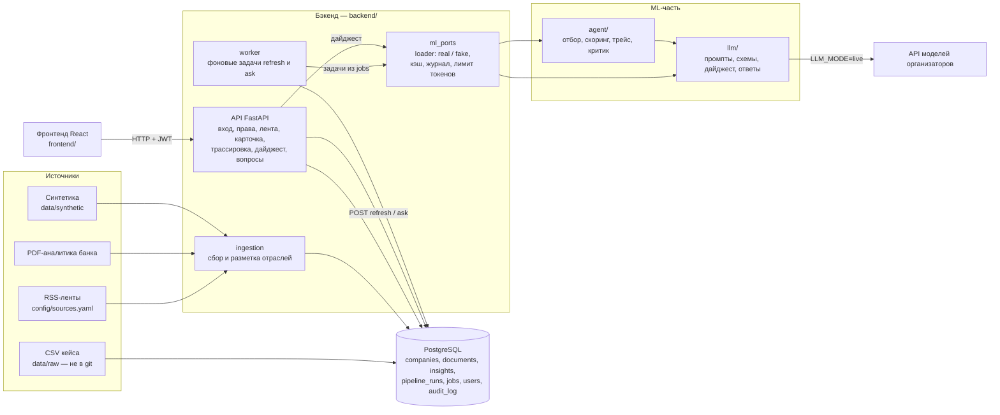

# News2Value — новостная аналитика для бизнес-решений

Команда News2Value, Альфа-Хакатон 2026.

**Версия на момент дедлайна: commit hash / tag: ___**

**Демо:** [news2value-web.onrender.com](https://news2value-web.onrender.com) (интерфейс) · [news2value-api.onrender.com/docs](https://news2value-api.onrender.com/docs) (API). Вход — тестовые учётные записи ниже, пароль передаётся отдельно. Бесплатный сервер засыпает без запросов: первое открытие — около минуты.

## Зачем это

Руководителю крупной компании некогда читать весь поток новостей и аналитики. News2Value — сервис внутри интернет-банка для бизнеса. Он выбирает из новостей то, что касается конкретной компании (её отрасли, сырья, контрагентов, ВЭД, кредитов), и объясняет, что это значит для неё: риски и возможности, что можно сделать, как событие оценивает Альфа-Банк. Акценты зависят от роли читателя: собственник, гендиректор, финдиректор, казначей.

У каждого утверждения в карточке видно, откуда оно: факт из новости, позиция банка или вывод модели. Как именно получен инсайт — какие шаги прошёл агент, по каким источникам и признакам профиля — показывает трассировка (`GET /insights/{id}/trace`).

## Архитектура



Как проходит обновление ленты:
1. Фронтенд вызывает `POST /companies/{id}/insights/refresh?role=cfo`. API ставит задачу в таблицу `jobs` и сразу отвечает `202 {job_id}`.
2. Worker берёт задачу. `ml_ports/loader.py` выбирает генератор по `ML_MODE`: `real` — агент (`agent/`) через адаптер с таймаутом и повтором, `fake` — заглушка без ML.
3. Агент собирает профиль компании, ищет новости в `documents`, размечает их, отбирает, добавляет тезисы банка и пишет карточку из 6 блоков. Если включён критик, он проверяет карточку. Каждый шаг пишется в трейс.
4. Новые карточки заменяют прежние в `insights`. Запуск с шагами сохраняется в `pipeline_runs`, каждый вызов ML — в `audit_log`.
5. Лента — `GET /companies/{id}/insights`, карточка — `GET /insights/{id}`, трассировка — `GET /insights/{id}/trace`.

Таблицы и связи — [docs/data-model.md](docs/data-model.md).

### Как агент приходит к выводу

Оркестрация своя, без готовых агентных фреймворков (`agent/orchestrator.py`). На каждый запуск:

1. **План** под компанию и роль читателя: какая отрасль, регион, продукты банка, что искать.
2. **Поиск новостей** за период. Если ничего нет — окно расширяется, это видно в трейсе.
3. **Разметка** новостей моделью: тип события, макрофакторы и их направление, отрасли. Чего модель не разметила — разметка по словарю.
4. **Отбор**. Скор складывается из нескольких частей:
   - связь с компанией: чувствительность отрасли к факторам (`llm/okved/okved_sensitivity.csv`), регион, сырьё, страны ВЭД, контрагенты;
   - тип события и свежесть;
   - веса роли читателя.

   Дальше дубли схлопываются, порог 0.5, в ленте до 5 карточек.
5. **Аналитика банка** к каждому событию: тезисы ЦМИ Альфа-Банка с учётом фактора и отрасли компании.
6. **Карточка из 6 блоков** с разметкой «факт / позиция банка / вывод ИИ» у каждого утверждения.
7. **Самопроверка**:
   - кодом: числа, ссылки на источники, дословность позиции банка; при ошибке модель исправляет ответ;
   - критиком: вторым вызовом модели, при замечаниях — одна доработка;
   - если критику не хватает данных — агент один раз ищет недостающее (тезисы, связанные новости) и пишет карточку заново.

   Модель недоступна или ответ не прошёл проверку — карточка по правилам с низкой уверенностью.

Каждый шаг пишется в трейс со входом, выходом, временем и статусом (`ok` / `fallback` / `skipped`). Подробно — [agent/README.md](agent/README.md).

## Безопасность

Коротко, подробно — [docs/SECURITY.md](docs/SECURITY.md):

- **Права.** Вход по JWT, пароли в bcrypt. Пользователь видит только свою компанию, на чужую — 403. При `AUTH_ENABLED=true` без токена — 401.
- **Данные.** Секреты только в `.env`. Логи маскируют email, токены и ключи. Журнал `audit_log` хранит вызовы ML без текстов профилей и новостей. CSV кейса в git не попадают. На сервере база не открыта наружу, с доменом включается HTTPS.
- **Действия ИИ.** Модель ничего не исполняет и не вызывает инструменты сама. Набор поисков зашит в коде, циклы ограничены, есть дневной лимит расхода. Каждый ответ проверяется кодом: схема, источники, числа, позиция банка. Каждый шаг виден в трейсе.

## Качество и масштабирование

Метрики, их текущие значения и мониторинг в эксплуатации — [llm/METRICS.md](llm/METRICS.md).

| что меряем | значение |
|---|---|
| отбор: P@5 / R@5 / nDCG@5 на новостях, которых не было при разработке | 0,96 / 0,96 / 0,96 |
| карточки: есть позиция банка | 100% |
| карточки: «почему важно» опирается на признак компании | 100% |
| шум (реклама, спорт, нерелевантное) не попал в ленту | 3 из 3 |

Как пересчитать: `python -m agent eval` и `python -m llm.eval_run --critic`.

Как растёт система: новые отрасли — строки в карте ОКВЭД, новые материалы банка — тезисы с факторами и отраслями, новые роли — словарь ролей. Модели задаются переменными окружения. Конвейер при этом не меняется.

## Что нужно на компьютере

- **Docker** с Docker Compose v2 (Docker Desktop на Windows и macOS). Этого достаточно для запуска.
- Для тестов и скриптов вне контейнера: **Python 3.12** и **[uv](https://docs.astral.sh/uv/)** (`pip install uv`).
- Для интерфейса без Docker (разработка): **Node.js 20+**.
- Свободные порты 8000 (API) и 5432 (база; если занят — см. шаг 1).
- Интернет нужен только для сборки образа. Демо-сценарий работает без него.

## Запуск с чистого клона

```bash
git clone https://github.com/d-kh233/news2value-news-analytics-for-business-decisions news2value
cd news2value

# 1. Настройки: шаблон подходит как есть.
#    Если на компьютере уже есть свой PostgreSQL на 5432, поменяйте в .env POSTGRES_HOST_PORT=5433
cp .env.example .env

# 2. База, API и worker. API при старте сам применяет миграции
docker compose up --build -d

# 3. Демо-данные: 30 синтетических компаний, 13 новостей, демо-профили, тестовые пользователи
#    и инсайты трёх демо-компаний (около 10 секунд, без интернета)
docker compose exec api python scripts/seed_demo.py

# 4. Проверка всего сценария: все шаги должны быть [OK]
docker compose exec api python scripts/e2e_check.py
```

Если в `data/raw/` лежат CSV кейса, `seed_demo.py` возьмёт их вместо синтетики. Выбрать явно: `--source synthetic` или `--source raw`.

Адреса:
- API: http://localhost:8000. Проверка: http://localhost:8000/health → `{"status": "ok"}`
- Документация API (можно пробовать запросы): http://localhost:8000/docs
- Логи: `docker compose logs -f api`, `docker compose logs -f worker`
- Остановить: `docker compose down` (данные базы сохранятся)

Интерфейс: `cd frontend && npm install && npm run dev` → http://localhost:5173. Чтобы он работал с API, а не с моками, создайте `frontend/.env` со строкой `VITE_USE_MOCKS=false` (запросы на `/api` Vite передаёт в API на :8000). На сервере интерфейс собирается в контейнер `web` и открывается на том же адресе, что и API ([docs/DEPLOY.md](docs/DEPLOY.md)).

Сервер (HTTPS, Caddy, откат) — [docs/DEPLOY.md](docs/DEPLOY.md).

## Тестовые учётные записи

Создаются шагом 3 (`seed_demo.py`) или отдельно: `docker compose exec api python scripts/create_demo_users.py`. Пароль у всех один — значение `DEMO_USER_PASSWORD` из `.env` (в шаблоне `change_me_demo`; на сервере его задают свой и передают эксперту отдельно).

| email | роль | что видит |
|---|---|---|
| `admin@news2value.demo` | admin | все компании, служебные `/documents` и `/feedback/stats` |
| `owner.stroy@news2value.demo` | owner (собственник) | только U_67064 — АО «Демо-Девелопмент», строительство жилья |
| `cfo.stroy@news2value.demo` | cfo (финдиректор) | только U_67064 — та же компания, другой взгляд |
| `treasurer.azs@news2value.demo` | treasurer (казначей) | только U_19717 — сеть АЗС |

По умолчанию `AUTH_ENABLED=false`: вход не требуется, все запросы идут от администратора `demo`. Чтобы проверить права, поставьте в `.env` `AUTH_ENABLED=true` и выполните `docker compose up -d`. Тогда без токена API отвечает 401, а на чужую компанию — 403.

## Сценарий проверки для эксперта

Быстро и целиком: `docker compose exec api python scripts/e2e_check.py`. Для сервера: `uv run python scripts/e2e_check.py --base-url https://<адрес>` из `backend/`.

Вручную в http://localhost:8000/docs:
1. **Вход.** `POST /auth/login` с `{"email": "cfo.stroy@news2value.demo", "password": "<DEMO_USER_PASSWORD>"}`. Скопируйте `access_token`, нажмите **Authorize** вверху страницы и вставьте токен. При `AUTH_ENABLED=false` этот шаг можно пропустить.
2. **Компании.** `GET /companies`: финдиректор видит только свою компанию U_67064.
3. **Профиль.** `GET /companies/U_67064/profile`: данные банка и ручные поля (сырьё, клиенты, цели), в `field_sources` указано, откуда каждое поле.
4. **Обновление.** `POST /companies/U_67064/insights/refresh` → `job_id`. Затем `GET /jobs/{job_id}`, пока не будет `done` (несколько секунд).
5. **Лента.** `GET /companies/U_67064/insights`: карточки, сначала важные. Фильтры: `type`, `min_importance`, `date_from`/`date_to`, `industry=41`.
6. **Карточка.** `GET /insights/{id}`: 6 блоков в `details`, у каждого утверждения `origin` (`fact` / `bank` / `ai`) и ссылки на источники.
7. **Трассировка.** `GET /insights/{id}/trace`: шаги агента со временем каждого, документы-источники, признаки профиля, `prompt_version`, `generated_by`.
8. **Дайджест.** `GET /companies/U_67064/digest?period=week`.
9. **Вопрос по инсайту.** `POST /insights/{id}/ask` с `{"question": "Что делать с закупками цемента?"}` → `GET /jobs/{job_id}/result`.
10. **Права.** `GET /companies/U_19717/profile` от финдиректора стройкомпании → 403.

Без ключа модели (`LLM_MODE=stub`) карточки собираются по шаблонам: `generated_by=rules`, заголовки вида «Риск: металлы — для отрасли …». С ключом или записанным кэшем (`LLM_MODE=live` / `replay`) их пишет модель (`generated_by=llm`).

В демо (`replay`, без ключа) записаны ответы модели для трёх демо-компаний во всех шести ролях (90 карточек) и для вопросов-подсказок в чате («Как это скажется на нашей долговой нагрузке?», «Что сделать в ближайший месяц?», «Какие продукты банка помогут снизить риск?», «Как это повлияет на закупки?») к карточкам гендиректора всех трёх компаний, финдиректора и собственника стройки, казначея АЗС. На другой вопрос без ключа чат отвечает шаблоном со ссылками на источники карточки и прямо пишет, что модель не вызывалась.

## Переменные окружения

Все переменные с пояснениями — в [.env.example](.env.example). Секреты хранятся только в `.env`, файл в `.gitignore`.

| переменная | по умолчанию | что это |
|---|---|---|
| `POSTGRES_USER`, `POSTGRES_PASSWORD`, `POSTGRES_DB` | `news2value`, `change_me`, `news2value` | база данных (на сервере — свой пароль) |
| `DATABASE_URL` | `postgresql://news2value:change_me@db:5432/news2value` | адрес базы для API; пароль тот же |
| `POSTGRES_HOST_PORT` | `5432` | порт базы на компьютере (только 127.0.0.1) |
| `LOG_LEVEL` | `INFO` | подробность логов |
| `CORS_ORIGINS` | localhost:3000, :5173 | адреса фронтенда (JSON-список) |
| `FRONTEND_ORIGIN` | — | адрес фронтенда на сервере, добавляется к `CORS_ORIGINS` |
| `AUTH_ENABLED` | `false` | `true` — нужен вход, права по компаниям |
| `JWT_SECRET` | заглушка | секрет подписи токенов; при `AUTH_ENABLED=true` обязателен |
| `JWT_EXPIRE_MINUTES` | `720` | срок жизни токена |
| `DEMO_USER_PASSWORD` | `change_me_demo` | пароль тестовых пользователей |
| `ML_MODE` | `real` | `real` — агент и LLM-часть; `fake` — заглушка без ML (откат) |
| `NEWS_SOURCE` | `mock` | `db` — новости из базы (`seed_demo.py` ставит сам); `mock` — моки агента |
| `USE_MOCKS` | `false` | `true` — лента, дайджест, вопросы из моков `data/mocks` (запасной режим) |
| `CACHE_ENABLED` | `0` | `1` — кэш ответов генератора в таблице `llm_cache` |
| `LLM_DAILY_TOKEN_LIMIT` | `0` | токенов модели в сутки по журналу; `0` — без лимита |
| `ML_TIMEOUT_SECONDS`, `ML_AGENT_TIMEOUT_SECONDS`, `ML_RETRIES` | `60`, `300`, `1` | таймауты и повтор вызовов ML в `ML_MODE=real` |
| `JOB_TIMEOUT_MINUTES`, `WORKER_POLL_SECONDS` | `10`, `1` | зависшая задача и частота опроса очереди |
| `FAKE_DELAY_SECONDS` | `0` | пауза заглушки на карточку (проверка фоновой работы) |
| `LLM_MODE` | `stub` | `stub` — без модели; `live` — с моделью и записью ответов; `replay` — только записанные ответы (для жюри) |
| `LLM_BASE_URL`, `LLM_API_KEY` | — | API моделей организаторов; ключ — только в `.env` |
| `LLM_MODEL_FAST` / `_SMART` / `_RESEARCH` | id из чата организаторов | модели (см. THIRD_PARTY_NOTICES) |
| `LLM_USE_SMART`, `LLM_USE_CRITIC`, `LLM_JSON_MODE` | `0`, `1`, `1` | модель интерпретации, критик, JSON-режим |
| `LLM_DAILY_BUDGET_RUB`, `LLM_PRICE_RUB_PER_1K` | `500`, `0.025` | рублёвый лимит агента; цена — по фактическому расходу 25.10 |
| `LLM_CACHE_DIR`, `AGENT_TODAY`, `TOP_K_NEWS`, `MIN_RELEVANCE`, `TEAM_MEMBER` | см. шаблон | кэш моделей, «сегодня» агента, отбор, кто тратит лимит |
| `DOMAIN`, `HTTP_PORT`, `HTTPS_PORT` | —, `80`, `443` | только сервер (`docker-compose.prod.yml`) |

## Компоненты

| папка | что внутри | подробнее |
|---|---|---|
| `backend/app/api/` | роуты: вход, компании, профиль, лента, карточка, трассировка, дайджест, вопросы, оценки, задачи | [docs/api-contract.md](docs/api-contract.md) |
| `backend/app/services/` | бизнес-логика: refresh, задачи, лента, трассировка, вход, журнал, синтетические новости | |
| `backend/app/ml_ports/` | стык с ML: `base.py` (интерфейсы), `loader.py` (real / fake), `real.py` (таймаут, повтор, `MLError`), `audit.py` (журнал и лимит), порты агента, дайджеста, ответов, новостей | [docs/ml-integration-notes.md](docs/ml-integration-notes.md) |
| `backend/app/ingestion/` | сбор RSS и PDF, нормализация, дубли, robots.txt | |
| `backend/app/worker.py` | фоновый процесс: задачи refresh и ask из таблицы `jobs` | |
| `backend/scripts/` | `seed_demo.py`, `e2e_check.py`, `create_demo_users.py`, `make_synthetic.py`, `check_ml_contract.py`, `load_csv.py`, `ingest.py`, `run_pipeline.py` | docstring каждого скрипта |
| `agent/` | агент: план, отбор и скоринг новостей, тезисы банка, трейс, критик, LLM-шлюз | [agent/README.md](agent/README.md) |
| `llm/` | промпты, JSON-схемы, разметка событий, карточка, дайджест, ответы, карта ОКВЭД | [llm/README.md](llm/README.md) |
| `data/synthetic/` | синтетические компании, связи, платежи и новости (в git) | `backend/scripts/make_synthetic.py` |
| `data/demo_profiles/`, `data/mocks/` | ручные профили демо-компаний, моки API | |
| `replay_cache/` | записанные ответы моделей для `LLM_MODE=replay` | |
| `docker-compose.yml` | локальный запуск: db, api, worker | |
| `docker-compose.prod.yml`, `deploy/Caddyfile` | сервер: db, api, worker за Caddy | [docs/DEPLOY.md](docs/DEPLOY.md) |

### Модель и запись ответов для жюри (ML-команда)

Жюри смотрит в `LLM_MODE=replay`: ответы модели берутся из `replay_cache/llm/`, ключ не нужен. Чтобы replay находил ответы, запросы к модели должны совпадать с записанными, поэтому запись и показ идут с одинаковыми настройками из шаблона: `NEWS_SOURCE=db`, `AGENT_TODAY=2026-10-25`, `LLM_USE_SMART=1`, `LLM_USE_CRITIC=1`, те же `LLM_MODEL_*`. От `AGENT_TODAY` считаются даты синтетических новостей, так что результат не зависит от того, в какой день жюри запускает сервис.

Записать (один раз, нужен ключ):
```bash
# в .env: LLM_BASE_URL и LLM_API_KEY; остальное — как в шаблоне (LLM_MODE=replay оставить)
# база — с нуля, как у жюри: id документов входят в запросы к модели
docker compose down -v
docker compose up -d --build
docker compose exec api python scripts/seed_demo.py --source synthetic

# демо-компании во всех ролях: сначала роли тестовых пользователей, потом остальные.
# Прерванную запись можно запустить заново: записанное повторно не оплачивается
docker compose exec -e LLM_MODE=live -e ML_AGENT_TIMEOUT_SECONDS=1800 api sh -c '
  for pair in U_67064:cfo U_67064:owner U_19717:treasurer U_67064:ceo U_19717:ceo U_16346:ceo \
              U_67064:treasurer U_67064:accountant U_67064:procurement U_19717:owner U_19717:cfo \
              U_19717:accountant U_19717:procurement U_16346:owner U_16346:cfo U_16346:treasurer \
              U_16346:accountant U_16346:procurement; do
    python scripts/run_pipeline.py --company ${pair%%:*} --role ${pair##*:}
  done' | tee record.log
```

Проверить без ключа и без новых вызовов — тот же цикл без `-e LLM_MODE=live ...`, вывод в `record-check.log`. Карточки должны быть от модели:
```bash
grep -c "  llm  " record-check.log     # сколько карточек от модели
grep -c "  rules  " record-check.log   # должно быть 0 (или столько же, сколько при записи)
```
Затем закоммитить `replay_cache/llm/` — после решения команды, можно ли его публиковать: в записанных запросах есть строки профилей компаний.

Папка `replay_cache/` подключена к контейнерам `api` и `worker` томом (`docker-compose.yml`), поэтому записанное сразу оказывается в репозитории. Лимит команды — 500 ₽ в день, расход виден в `replay_cache/llm/usage-ДАТА.json`; оценка — 0,1–0,2 ₽ на карточку с критиком. Дополнительно можно ограничить токены в сутки через `LLM_DAILY_TOKEN_LIMIT`.

Записано 25.10: 18 прогонов, 90 карточек — все от модели, 13 вопросов чата; проверка с нуля в replay — 90 из 90 карточек от модели. Реальный расход — 23 ₽ за день.

Без бэкенда (только агент, профили из CSV): `python -m agent run --company MOCK-002 --role cfo`; для запасного режима `USE_MOCKS=true` (компании `c-001`…`c-003`) — `python -m agent record-demo`.

## Тесты и проверки

```bash
cd backend
uv sync
uv run pytest -rs                                   # тесты API (нужна запущенная база из docker compose)
ML_MODE=fake uv run pytest -q                       # то же в режиме заглушки
uv run ruff check .                                 # линтер
ML_MODE=real uv run python scripts/check_ml_contract.py   # стык с агентом и real-адаптеры
uv run python scripts/e2e_check.py                  # сквозной сценарий против запущенного API
cd .. && backend/.venv/Scripts/python -m unittest llm.tests.test_offline llm.tests.test_digest_qa agent.tests.test_agent agent.tests.test_heuristic  # ML без сети (Linux/macOS: backend/.venv/bin/python)
backend/.venv/Scripts/python -m agent eval          # качество отбора на размеченном наборе
```

Тесты с базой работают в отдельной базе `news2value_test` (создаётся сама). Если PostgreSQL не запущена, они пропускаются — `-rs` покажет, какие.

## Документы

- [docs/api-contract.md](docs/api-contract.md) — контракт API для фронтенда; [docs/openapi.json](docs/openapi.json) — машинная схема
- [docs/data-model.md](docs/data-model.md) — таблицы и связи
- [docs/SECURITY.md](docs/SECURITY.md) — что сделано и что нет в безопасности прототипа
- [docs/DEPLOY.md](docs/DEPLOY.md) — деплой на сервер, обновление, логи, откат; [deploy/README.md](deploy/README.md) — что в папке `deploy/`
- [agent/README.md](agent/README.md) — агент: шаги, отбор и его веса, тезисы банка, самопроверка, критик, режимы модели
- [llm/README.md](llm/README.md) — промпты, схемы, карта ОКВЭД; [llm/METRICS.md](llm/METRICS.md) — метрики качества и мониторинг
- [docs/ml-integration-notes.md](docs/ml-integration-notes.md) — стык бэкенда с агентом и найденные расхождения
- [docs/llm-fixes-handoff.md](docs/llm-fixes-handoff.md) — что бэкенд временно сделал в `llm/` и `agent/`
- [THIRD_PARTY_NOTICES.md](THIRD_PARTY_NOTICES.md) — библиотеки, модели, данные, источники, смоделированные интеграции
- [ROLES.md](ROLES.md) — команда и вклад
