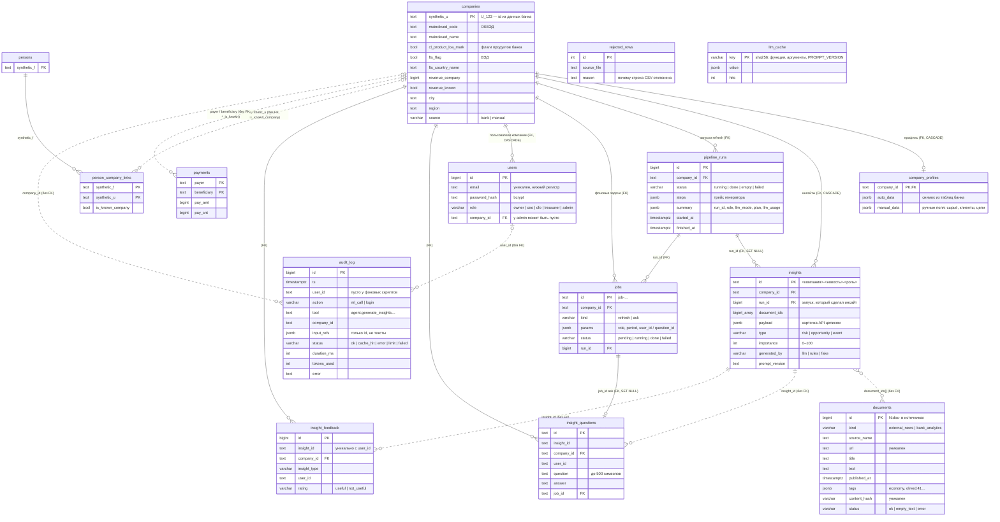

# Модель данных News2Value

PostgreSQL 16. Таблицы создают миграции Alembic (`backend/migrations/versions/0001…0009`), ORM-модели лежат в `backend/app/models/`. Схема API — [openapi.json](openapi.json), описание для фронтенда — [api-contract.md](api-contract.md).

Сплошная линия на схеме — внешний ключ (FK: база сама следит за связью). Пунктир — логическая связь без FK, её проверяет код. Почему FK нет: в данных банка много ссылок на компании, которых нет в справочнике, а вопросы, оценки и журнал должны пережить пересоздание инсайтов при `refresh`.

## Таблицы по модулям

| модуль | таблицы | что хранят |
|---|---|---|
| B2 данные банка | `companies`, `persons`, `person_company_links`, `payments`, `rejected_rows` | CSV кейса (или синтетика `data/synthetic/`). Повторная загрузка не создаёт дублей |
| B3 профили | `company_profiles` | автоматическая часть из таблиц банка + ручные поля (ручные главнее) |
| B4 документы | `documents` | новости RSS, PDF-аналитика банка, синтетические новости. Дубли отсекаются по `url` и `content_hash` |
| B5 инсайты | `insights`, `pipeline_runs` | карточки и журнал запусков `refresh`: шаги, статус, ошибка |
| B6 задачи и кэш | `jobs`, `llm_cache` | очередь фоновых задач на PostgreSQL (одна активная refresh-задача на компанию), кэш ответов генератора |
| B7b вопросы и оценки | `insight_questions`, `insight_feedback` | вопросы по инсайту с ответами, оценки «полезно / нет» |
| B8+B9 доступ и журнал | `users`, `audit_log`, `insights.run_id` | пользователи и роли, журнал вызовов ML и входов, ссылка инсайта на запуск для `GET /insights/{id}/trace` |

## Важные правила

- `refresh` в одной транзакции удаляет все инсайты компании и вставляет новые. Поэтому у вопросов, оценок и журнала нет FK на `insights`.
- Удаление компании (`DELETE /companies/{id}`, только `source=manual`) удаляет её профиль, инсайты и пользователей. Журнал `audit_log` остаётся.
- В `audit_log` и логах нет текстов новостей, профилей и вопросов — только id (см. [SECURITY.md](SECURITY.md)).
